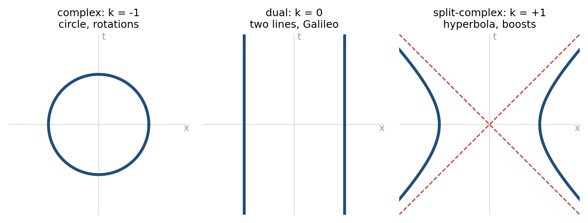
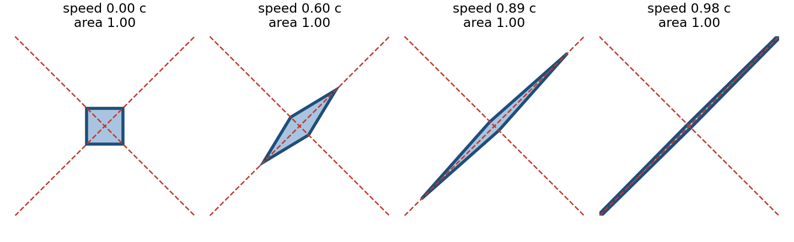
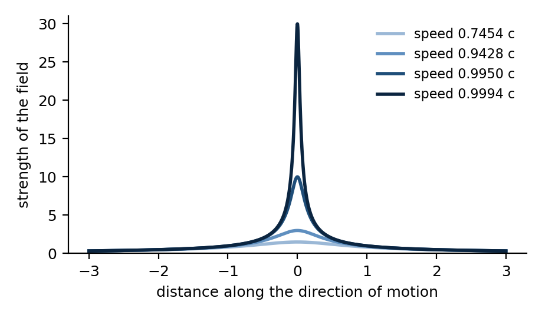
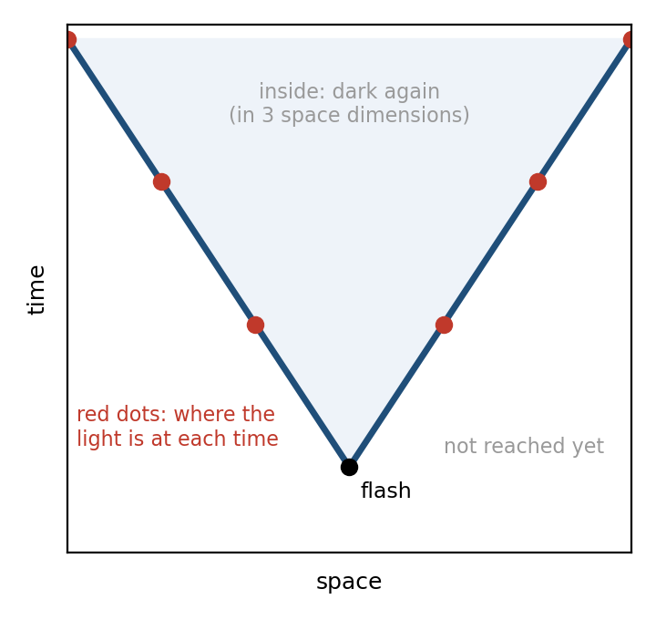
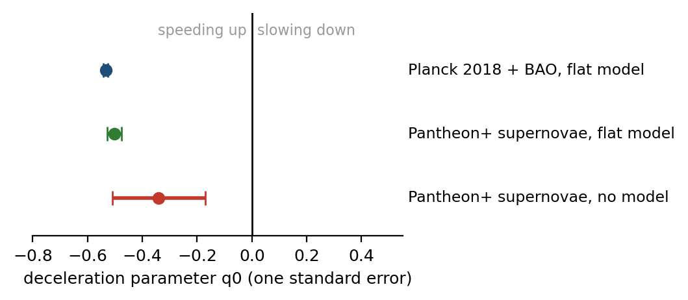

DOI of this text: [doi:10.5281/zenodo.24596477](https://doi.org/10.5281/zenodo.24596477)

This is a beginner text. It asks how much of spacetime you can build from one very small piece of mathematics, and it follows the answer step by step. It needs school algebra and a little patience. It uses a few formulas, each one explained.

**Nothing in this text is a new result.** Every result below is known, and each one is credited to its authors where it appears. The text only tells the story in one order, from one formula. Where we ran a computation ourselves, we say so, and it is only a check of a published result. A list of works, with identifiers, closes the text.

# One formula, three number planes

Take two numbers, a position $x$ and a time $t$. Combine them in one formula:

$$x^2 - k\,t^2.$$

That is all we start with. The letter $k$ is a knob. It can be negative, zero or positive. Each setting gives a different plane, with a different shape for "everything at distance one".

**k negative: the complex plane.** Set $k=-1$. The formula is $x^2+t^2$. The points where it equals one form a **circle**. The numbers are the familiar complex numbers $x+it$, with $i^2=-1$. Multiplying by a number on the circle **rotates** the plane. Nothing is stretched. Lengths stay the same.

**k zero: the dual plane.** Set $k=0$. The formula is just $x^2$, and time drops out. The points where it equals one are **two parallel lines**. The numbers are $x+\varepsilon t$, with $\varepsilon^2=0$. Multiplying by $1+\varepsilon v$ slides each point sideways by an amount proportional to its time, $x \to x+vt$, and leaves time alone. This is **Galileo's** rule for moving at speed $v$: time is the same for everyone, positions shift.

**k positive: the split-complex plane.** Set $k=1$. The formula is $x^2-t^2$. The points where it equals one form a **hyperbola**. The numbers are $x+jt$, with $j^2=+1$. Multiplying by $\cosh\eta+j\sinh\eta$ moves each point along a hyperbola. This is a **boost**, the change of viewpoint of special relativity. The number $\eta$ is the *rapidity*. Rapidities simply add when you boost twice.

{width=100%}

The split-complex plane has a feature the other two lack. The formula is zero on two straight lines, $x=t$ and $x=-t$. These lines are **light**. A ray of light covers one unit of distance in one unit of time. Every boost leaves these two lines where they are. The speed of light is the same for everyone because the lines never move.

This three-way picture is old. Felix Klein described the family of geometries in 1871 [Kle71]. Isaak Yaglom wrote the standard book on the three planes, *A Simple Non-Euclidean Geometry and Its Physical Basis* [Yag79].

**One step is a choice, not a derivation.** Nothing in the circle forces the minus sign in front of $t^2$. We put it in. Where the sign comes from is a real question. In 1910 Ignatowski [Ign10] showed that very plain assumptions leave one unknown constant. These assumptions are that all moving viewpoints are equal, that space is the same everywhere and that no direction is special. Lévy-Leblond [LL76] gave a modern version. They did not need a postulate about light. The constant is then fixed by experiment, and electrodynamics fixes it to be one over the speed of light squared. So the sign is an input from nature. A text that hid this would be cheating.

# Boosts squeeze, and light is a line

Look again at the boost. It is easier to see in new coordinates along the two light lines. Write $u=t-x$ and $v=t+x$. A boost does something very simple:

$$u \to e^{-\eta}\,u, \qquad v \to e^{\eta}\,v.$$

One direction is shrunk and the other is stretched, by the same factor. The product $uv$ never changes. The area of any shape never changes either, because the shrink and the stretch cancel. So a boost is an **area-preserving squeeze**.

Start with a square of area one. Boost it faster and faster. It becomes a thin diamond, then a thinner one. It always has area one. In the end it hugs the light line.

{width=100%}

At the speed of light the shape would be a line. Seen across that line, a shape of area one that gets thinner and thinner becomes a spike that is infinitely tall and infinitely thin, with total area one. Physicists call such a spike a **delta** and write it $\delta$. The delta is the idealised "unit impulse": all of the quantity in one point, none anywhere else, total one.

There is a catch, and it is worth saying. On the flat plane alone, a squeeze of area one does *not* produce a delta. The thin shape also grows very long along the light line, and the quantity it carries runs off to infinity. A delta appears when we hold one more thing fixed. The cleanest choice is the **energy**. That is what the physicists did.

## The shock wave

Take a mass $m$ moving at speed $v$. Let $\gamma$ be the usual relativity factor, which grows without limit as $v$ approaches the speed of light. Hold the energy $E=\gamma m$ fixed while you push $v$ toward the speed of light. The mass shrinks as the speed grows, and the energy stays the same.

The gravity of this moving mass is squeezed in the direction of motion. Its strength along the line of motion looks like the curves below. They get taller and thinner as the speed grows.

{width=65%}

In the limit, the field is all in one flat sheet that sweeps through space at the speed of light. Outside the sheet there is nothing. Inside it, the strength falls off with the distance $\rho$ from the path like $-8E\ln\rho$, in units where $G=c=1$. This is the **Aichelburg-Sexl shock wave**, found in 1971 [AS71]. Its metric has a delta in it:

$$ds^2=-du\,dv+dx_\perp^2-4E\ln(\rho^2)\,\delta(u)\,du^2 .$$

You can read this without knowing general relativity. The first two terms are flat space. The last term is the squeezed mass: it exists only where $u=0$, which is the sheet, and its size is set by the distance from the path. Dray and 't Hooft [DtH85] showed in 1985 how to glue the two flat halves of space together across such a sheet.

Mathematicians first found this limit delicate. A delta times a curved-space formula is not obviously meaningful. The question was settled with rigorous methods by Balasin and Nachbagauer in the 1990s [BN95] and, for the path of a test particle through the shock, by Steinbauer [Ste98], who smoothed the delta, solved the equations, and showed that the limit does not depend on how it was smoothed.

## A worked example: a spinning mass

What if the mass spins? The answer is a good test of the idea, and it is known.

A spinning black hole is described by the Kerr solution. It has a spin length $a$. There is a classical trick behind it. Newman and Janis [NJ65] noticed in 1965 that the field of a spinning mass looks like the field of a plain mass placed at an *imaginary* point, a point shifted by $ia$ along the spin axis. The complex number $i$ is back, and it does real work. The source of Kerr is a flat disk of radius $a$, as Israel showed in 1970 [Isr70].

Now do the same limit. Push the spinning hole to the speed of light, keep its energy and its spin length fixed. The result was worked out by Balasin and Nachbagauer. It depends on the direction of the push.

- **Pushed along the spin axis.** [BN95] Outside a circle of radius $a$, the shock is exactly the Aichelburg-Sexl shock of a non-spinning mass. Inside, it is different. The source is the whole **disk** of radius $a$, with a sharp **rim**. The disk carries a little negative energy, the rim carries a lot of positive energy, and the total is the same as for the plain mass.
- **Pushed across the spin axis.** [BN96] The source is a **single point**, moved sideways by the distance $a$. Barrabès and Hogan [BH03] confirmed this by a different route.

A natural guess is a ring in the first case and a short line in the second. That guess is wrong in our four dimensions. Yoshino [Yos05] showed that the ring and the line do appear, but only in spacetimes with five or more dimensions.

{width=100%}

One lesson stands out. Far from the axis, the spinning shock looks exactly like the non-spinning one. The spin shows up only within the distance $a$, as the disk and the shifted point. This agrees with the recent study of Adamo, Cristofoli and Tourkine [ACT23] of the light-speed limit of Kerr.

**What we did.** We recomputed the profile along the axis and across it by direct numerical integration and found that it matches the published formulas to twenty digits. This is a check of known work. It adds no new claim.

**A pointer.** The shift to an imaginary point has a cousin in a book. Jason Glowney's *Arithmoí*, Book 1, section 1.6.7 [Glo23], treats the Dirac delta as an impulse placed at a **complex** point, and ties it to Lie algebras and to the Fourier transform. The spinning example above is a physical case of a delta at a complex point. The book has the full account of that idea. We do not reproduce it here.

# The light cone is where the delta lives

Switch on a lamp for an instant. Where is the light a moment later? On a sphere. Its radius is the time that has passed, times the speed of light. Nowhere inside the sphere and nowhere outside.

The mathematics of this is a delta again. The wave of a single flash in three space dimensions is, up to a constant,

$$G=\frac{\delta(t-r)}{4\pi r}.$$

Here $r$ is the distance from the flash. The delta is zero everywhere except where $t=r$. The set where a function is not zero is called its **support**. So the support of the flash is the **light cone**: the points that light from the flash can reach at exactly the speed of light, no sooner and no later.

{width=50%}

This is called **Huygens' principle** in its sharp form. It is a special property of space. In an odd number of space dimensions, three or more, a flash is sharp [Had23]. In two space dimensions it is not: the flash leaves a slowly fading tail behind it, inside the cone. In curved space even three dimensions have tails, because the curvature scatters some light backwards [DB60, Pri72].

The two stories meet. In the shock wave of the last section, the delta $\delta(u)$ lives on the sheet $u=0$. That sheet is a flat light cone seen from very far away: a cone with its tip at infinity. A delta whose support is a null surface is the common shape of both.

The same idea carries on in a harder setting. The introduction [Per26i] to a recent paper on how far gravity can distort a cone of light [Per26] shows a cone of light rays, and asks how much its shape can twist before the rays cross.

# Three complex coordinates

So far we had two numbers, $x$ and $t$. Real space has three directions. Give each direction a **complex** number. Take three complex numbers $z_1, z_2, z_3$. Combine them in the same kind of formula:

$$z_1^2+z_2^2+z_3^2 .$$

Which changes of coordinates leave this formula alone? A rotation by a real angle is one. Rotate about each of three axes and you get the three ordinary rotations. But the numbers are complex, so the angle may be complex too. An angle $i\theta$ turns $\cos$ into $\cosh$ and $\sin$ into $i\sinh$. The result is no longer a rotation. It is a **boost**.

So there are six independent changes: three real angles (the three rotations) and three imaginary angles (the three boosts). Together they form a group called $SO(3,\mathbb C)$. It is a classical fact that this is the same group as the Lorentz group of special relativity, the group of all rotations and boosts [PR84]. The six pieces are the six generators of the Lorentz group.

The electric and magnetic fields give the best example. Put them in one complex vector:

$$F=E+iB.$$

A real rotation turns $E$ and $B$ together, each in its own way. An imaginary rotation mixes $E$ into $B$ and $B$ into $E$: this is how a moving observer sees a magnetic field where a still one saw an electric field. Now look for what does not change. The formula $F\cdot F$ is unchanged, and it has two parts, a real part and an imaginary part:

$$F\cdot F=(E^2-B^2)+2i\,E\!\cdot\!B .$$

So there are two numbers that every observer agrees on: $E^2-B^2$ and $E\cdot B$. This is textbook electromagnetism, written in one line.

The same trick works for the three planes of the first section. Swap $i$ for $\varepsilon$, and you get the Galilean version of electromagnetism, with its separate electric and magnetic limits [LBLL73]. Keep $i$ and you get the Lorentz case. The knob $k$ chooses the geometry here just as it did in the first section.

**A caution.** Six numbers are not six dimensions of spacetime. We tried the idea of reading the six as three times and three spaces. It fails the tests, because with more than one time the equations lose their predictions [Dor70, Teg97], and a check against the measured expansion of the universe also fails. What is left is purely mathematical. The six numbers count the *changes* of viewpoint, the rotations and boosts. They are not directions of space.

# The menu of possible spacetimes

Everything so far assumes the usual world. What other worlds does the mathematics allow? In 1968 Bacry and Lévy-Leblond [BLL68] answered this question for the symmetry of spacetime. They asked for the following. Space looks the same in every direction. Every place and moment is like every other. There are boosts, and they connect moving viewpoints. Then, with a few more assumptions such as causality, there are exactly **eleven** possible kinds of kinematics. That is the **menu**.

There are two knobs on the menu. They are the two curvatures of our one formula, set in two planes. One is the speed of light $c$, which is the curvature of the plane of space and time. The other is the cosmological constant $\Lambda$, which is the curvature of the whole spacetime at very large scale. Each knob can be positive, zero or negative, and the choices fill a grid.

| | $c$ finite | $c\to\infty$ | $c\to 0$ |
|:--|:--|:--|:--|
| $\Lambda>0$ | de Sitter | Newton-Hooke (expanding) | para-Euclidean |
| $\Lambda=0$ | Poincaré (special relativity) | Galilei (Newton) | Carroll |
| $\Lambda<0$ | anti-de Sitter | Newton-Hooke (oscillating) | para-Poincaré |

Table: The main kinds of spacetime symmetry. The other two of the eleven, called para-Galilei and static, are further limits. Each column is a limit of the first. The two cells of the last column are the carrollian de Sitter and anti-de Sitter spacetimes, called para-Euclidean and para-Minkowski, whose symmetry algebras are the para-Euclidean and para-Poincaré algebras [FP19]. The method of taking such limits is due to Inönü and Wigner [IW53].

The middle of the table is the world we learned at school. Take $c\to\infty$ and you get Galileo and Newton: time is the same for all. Take $c$ finite and $\Lambda=0$ and you get special relativity. Keep a small positive $\Lambda$ and you get de Sitter space, the space of an accelerating universe.

The three planes of the first section come back here in a precise form. Three-dimensional gravity has no waves and can be solved exactly. In three-dimensional gravity the symmetry group is built from unit quaternions over a ring that is the complex numbers, the dual numbers or the split-complex numbers, depending on the sign of $\Lambda$ [MS08]. So in that small world the statement "three number planes build the world" is literally true. This is a proved fact of Meusburger and Schroers. Whether the same neat construction exists in our four dimensions is an open question, which we do not answer.

**What the knobs fix, and what they do not.**

- They fix the speed of light $c$ and the cosmological constant $\Lambda$.
- They fix the two famous limits: Newton's (take $c\to\infty$) and Carroll's (take $c\to 0$).
- They do **not** fix the number of dimensions, three of space and one of time. That has separate arguments: Ehrenfest showed in 1917 that stable orbits need three space dimensions [Ehr17], and Huygens' principle wants an odd number of at least three, as in the last section. These two together point to three.
- They do **not** fix the forces, the masses of particles, the strength of the couplings, or the number of families of particles.

The menu lists what is possible. It does not say which world we live in.

# The Newton side: the data picks de Sitter

A mathematician lists what could be. A physicist asks the data. Here the data speak to one knob only: the sign of $\Lambda$.

**The afterglow of the Big Bang.** The Planck satellite measured the light left from the early universe. Its 2018 results, taken together with galaxy clustering as a ruler, give the Hubble constant $H_0=67.66\pm0.42$ km/s per Mpc and a share $\Omega_\Lambda=0.6889\pm0.0056$ of the energy in the form of $\Lambda$ [Pla20]. In a flat universe those two numbers give

$$\Lambda = \frac{3\,\Omega_\Lambda H_0^2}{c^2}=(1.106\pm0.016)\times10^{-52}\ \text{m}^{-2}.$$

This is positive, and the curvature radius of this de Sitter space is $\ell=\sqrt{3/\Lambda}\approx 5300$ Mpc, about 17 billion light years. The deceleration parameter, which says whether the expansion is speeding up (negative) or slowing down (positive), comes out at $q_0=-0.533\pm0.008$. The universe is speeding up. We computed these derived numbers ourselves from the published inputs.

**Exploding stars.** The Pantheon+ collection [Sco22, Bro22] gives the brightness of 1590 supernovae at known distances. We fitted the public data with its full error matrix. In the standard flat model, the share of matter comes out as $0.332\pm0.018$, which agrees with Planck at about one standard error, and $q_0=-0.502\pm0.027$.

The strong claim above rests on the standard model. What if we allow the expansion history to be any smooth curve? Then the supernovae alone give $q_0=-0.34\pm0.17$. That is a speeding-up universe at only about two standard errors. It is a hint and not a proof.

{width=75%}

**What this tells us.** Among the possible spacetimes of the menu, the data choose the de Sitter column: a small positive $\Lambda$, not zero and not negative. Two independent measurements agree on the sign. The result is conditional, because Planck's number assumes the standard model of cosmology.

**What it does not tell us.** It checks one sign. It does not test the idea that spacetime comes from three number planes. That idea has made no prediction that data could confirm or kill yet. On the scale of a laboratory the curvature is utterly negligible, about one part in $10^{26}$, which is why a flat spacetime works so well on Earth. Other checks sit on the same page: the speed of gravity equals the speed of light to about one part in $10^{15}$ [Abb17], and the time dilation of fast ions is confirmed to a few parts in $10^{9}$ [Bot14], and optical clocks have shown it at the speed of a walking person [Cho10]. They belong to the other knob, $c$. We have not redone them here.

# What this text does not do

It does not prove anything new. The chain from one formula to the Lorentz group, the shock wave, the spinning example, the menu of possible spacetimes and the data are the work of the authors credited. We have told them in one order.

It does not claim that a pattern of mathematics generates all of physics. That is a hope. The text shows how far one small piece of mathematics goes, and where it stops: the minus sign is put in by hand, the dimension is put in by hand, and the forces are not touched.

# Acknowledgements {-}

We are grateful to Jason Glowney, whose treatment of the Dirac delta and of the complex unit sphere in *Arithmoí*, Book 1, is the starting point of the delta thread in this text.

# Use of AI {-}

Claude (Anthropic) was used in November 2026, under the author's direction, for drafting, figures and checks.

# References {-}

The works are listed in the alphabetical order of their labels. Journal references are given in full. Where a permanent identifier exists (a DOI or an arXiv number) it is added. The works without one are Ignatowski's 1910 note, Ehrenfest's 1917 paper, Hadamard's lectures and the books, for which we found no DOI.

[Abb17] B. P. Abbott et al., *Gravitational waves and gamma-rays from a binary neutron star merger: GW170817 and GRB 170817A*, Astrophys. J. Lett. **848** (2017) L13, [doi:10.3847/2041-8213/aa920c](https://doi.org/10.3847/2041-8213/aa920c).

[ACT23] A. Adamo, A. Cristofoli, P. Tourkine, *The ultrarelativistic limit of Kerr*, JHEP **02** (2023) 107, [arXiv:2209.05730](https://arxiv.org/abs/2209.05730).

[AS71] P. C. Aichelburg, R. U. Sexl, *On the gravitational field of a massless particle*, Gen. Rel. Grav. **2** (1971) 303, [doi:10.1007/BF00758149](https://doi.org/10.1007/BF00758149).

[BLL68] H. Bacry, J.-M. Lévy-Leblond, *Possible kinematics*, J. Math. Phys. **9** (1968) 1605, [doi:10.1063/1.1664490](https://doi.org/10.1063/1.1664490).

[BN95] H. Balasin, H. Nachbagauer, *The ultrarelativistic Kerr geometry and its energy-momentum tensor*, Class. Quantum Grav. **12** (1995) 707, [arXiv:gr-qc/9405053](https://arxiv.org/abs/gr-qc/9405053), [doi:10.1088/0264-9381/12/3/009](https://doi.org/10.1088/0264-9381/12/3/009).

[BN96] H. Balasin, H. Nachbagauer, *Boosting the Kerr geometry into an arbitrary direction*, Class. Quantum Grav. **13** (1996) 731, [arXiv:gr-qc/9508044](https://arxiv.org/abs/gr-qc/9508044), [doi:10.1088/0264-9381/13/4/013](https://doi.org/10.1088/0264-9381/13/4/013).

[BH03] C. Barrabès, P. A. Hogan, *Light-like boost of the Kerr gravitational field*, Phys. Rev. D **67** (2003) 084028, [arXiv:gr-qc/0303055](https://arxiv.org/abs/gr-qc/0303055), [doi:10.1103/PhysRevD.67.084028](https://doi.org/10.1103/PhysRevD.67.084028).

[Bot14] B. Botermann et al., *Test of time dilation using stored Li+ ions as clocks at relativistic speed*, Phys. Rev. Lett. **113** (2014) 120405, [doi:10.1103/PhysRevLett.113.120405](https://doi.org/10.1103/PhysRevLett.113.120405).

[Bro22] D. Brout et al., *The Pantheon+ analysis: cosmological constraints*, Astrophys. J. **938** (2022) 110, [arXiv:2202.04077](https://arxiv.org/abs/2202.04077), [doi:10.3847/1538-4357/ac8e04](https://doi.org/10.3847/1538-4357/ac8e04).

[DB60] B. S. DeWitt, R. W. Brehme, *Radiation damping in a gravitational field*, Ann. Phys. **9** (1960) 220, [doi:10.1016/0003-4916(60)90030-0](https://doi.org/10.1016/0003-4916(60)90030-0).

[DtH85] T. Dray, G. 't Hooft, *The gravitational shock wave of a massless particle*, Nucl. Phys. B **253** (1985) 173, [doi:10.1016/0550-3213(85)90525-5](https://doi.org/10.1016/0550-3213(85)90525-5).

[Cho10] C. W. Chou, D. B. Hume, T. Rosenband, D. J. Wineland, *Optical clocks and relativity*, Science **329** (2010) 1630, [doi:10.1126/science.1192720](https://doi.org/10.1126/science.1192720).

[Dor70] J. Dorling, *The dimensionality of time*, Am. J. Phys. **38** (1970) 539, [doi:10.1119/1.1976386](https://doi.org/10.1119/1.1976386).

[Ehr17] P. Ehrenfest, *In what way does it become manifest in the fundamental laws of physics that space has three dimensions?*, Proc. Amsterdam Acad. **20** (1917) 200.

[Glo23] J. Glowney, *Arithmoí: A Study of Mathematical Cohesiveness in Physics and Metaphysics*, Book 1, First Edition, Athene Noctua, 2023.

[Had23] J. Hadamard, *Lectures on Cauchy's Problem in Linear Partial Differential Equations*, Yale University Press, 1923.

[Ign10] W. von Ignatowski, *Einige allgemeine Bemerkungen über das Relativitätsprinzip*, Phys. Z. **11** (1910) 972.

[Isr70] W. Israel, *Source of the Kerr metric*, Phys. Rev. D **2** (1970) 641, [doi:10.1103/PhysRevD.2.641](https://doi.org/10.1103/PhysRevD.2.641).

[IW53] E. Inönü, E. P. Wigner, *On the contraction of groups and their representations*, Proc. Natl. Acad. Sci. USA **39** (1953) 510, [doi:10.1073/pnas.39.6.510](https://doi.org/10.1073/pnas.39.6.510).

[FP19] J. M. Figueroa-O'Farrill, S. Prohazka, *Spatially isotropic homogeneous spacetimes*, JHEP **01** (2019) 229, [arXiv:1809.01224](https://arxiv.org/abs/1809.01224), [doi:10.1007/JHEP01(2019)229](https://doi.org/10.1007/JHEP01(2019)229).

[Kle71] F. Klein, *Ueber die sogenannte Nicht-Euklidische Geometrie*, Math. Ann. **4** (1871) 573, [doi:10.1007/BF02100583](https://doi.org/10.1007/BF02100583).

[LBLL73] M. Le Bellac, J.-M. Lévy-Leblond, *Galilean electromagnetism*, Nuovo Cimento B **14** (1973) 217, [doi:10.1007/BF02895715](https://doi.org/10.1007/BF02895715).

[LL76] J.-M. Lévy-Leblond, *One more derivation of the Lorentz transformation*, Am. J. Phys. **44** (1976) 271, [doi:10.1119/1.10490](https://doi.org/10.1119/1.10490).

[MS08] C. Meusburger, B. J. Schroers, *Quaternionic and Poisson-Lie structures in 3d gravity: the cosmological constant as deformation parameter*, J. Math. Phys. **49** (2008) 083510, [arXiv:0708.1507](https://arxiv.org/abs/0708.1507).

[NJ65] E. T. Newman, A. I. Janis, *Note on the Kerr spinning-particle metric*, J. Math. Phys. **6** (1965) 915, [doi:10.1063/1.1704350](https://doi.org/10.1063/1.1704350).

[PR84] R. Penrose, W. Rindler, *Spinors and Space-Time*, vol. 1, Cambridge University Press, 1984.

[Per26] M. Perreault, *Affine length bounds the conformal excursion on a null cone: a sharp focusing inequality*, 2026, Zenodo. [doi:10.5281/zenodo.24572220](https://doi.org/10.5281/zenodo.24572220).

[Per26i] M. Perreault, *How far can light twist a shape? An introduction to the paper above*, 2026, Zenodo. [doi:10.5281/zenodo.24576187](https://doi.org/10.5281/zenodo.24576187).

[Pla20] Planck Collaboration, *Planck 2018 results. VI. Cosmological parameters*, Astron. Astrophys. **641** (2020) A6, [arXiv:1807.06209](https://arxiv.org/abs/1807.06209), [doi:10.1051/0004-6361/201833910](https://doi.org/10.1051/0004-6361/201833910).

[Pri72] R. H. Price, *Nonspherical perturbations of relativistic gravitational collapse*, Phys. Rev. D **5** (1972) 2419, [doi:10.1103/PhysRevD.5.2419](https://doi.org/10.1103/PhysRevD.5.2419).

[Sco22] D. Scolnic et al., *The Pantheon+ analysis: the full data set and light-curve release*, Astrophys. J. **938** (2022) 113, [arXiv:2112.03863](https://arxiv.org/abs/2112.03863), [doi:10.3847/1538-4357/ac8b7a](https://doi.org/10.3847/1538-4357/ac8b7a).

[Ste98] R. Steinbauer, *Geodesics and geodesic deviation for impulsive gravitational waves*, J. Math. Phys. **39** (1998) 2201, [doi:10.1063/1.532283](https://doi.org/10.1063/1.532283).

[Teg97] M. Tegmark, *On the dimensionality of spacetime*, Class. Quantum Grav. **14** (1997) L69, [arXiv:gr-qc/9702052](https://arxiv.org/abs/gr-qc/9702052).

[Yag79] I. M. Yaglom, *A Simple Non-Euclidean Geometry and Its Physical Basis*, Springer, 1979, [doi:10.1007/978-1-4612-6135-3](https://doi.org/10.1007/978-1-4612-6135-3).

[Yos05] H. Yoshino, *Lightlike limit of the boosted Kerr black holes in higher-dimensional spacetimes*, Phys. Rev. D **71** (2005) 044032, [arXiv:gr-qc/0412071](https://arxiv.org/abs/gr-qc/0412071), [doi:10.1103/PhysRevD.71.044032](https://doi.org/10.1103/PhysRevD.71.044032).
